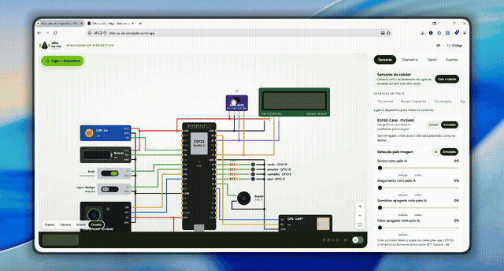
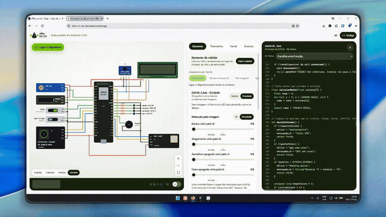
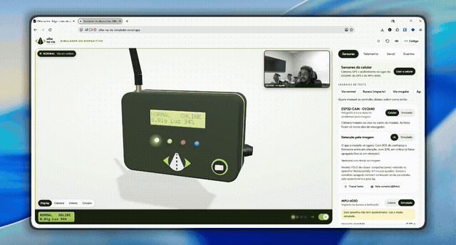

# Olho na Via · Dispositivo IoT de borda

Entrega de **Edge Computing & Computer Systems** · Global Solution 2026.2 · CitizenTech
Erick Nathan Capito Pereira · RM573635

Em São Paulo, um buraco, um alagamento ou um semáforo apagado só entra na fila de conserto quando alguém reclama. O **Olho na Via** coloca um dispositivo atrás do para-brisa dos ônibus, que já passam por quase todas as ruas. Ele olha a via, **decide sozinho** se há um problema e avisa quem está perto e a Prefeitura, mesmo sem internet.

**Simulador online:** [olho-na-via-simulador.vercel.app](https://olho-na-via-simulador.vercel.app)
**Documentação técnica:** [Documentacao Tecnica - Edge - Olho na Via.pdf](<Documentacao Tecnica - Edge - Olho na Via.pdf>)

## O dispositivo

[](docs/videos/01-dispositivo.mp4)

Na frente fica a câmera, que olha para a rua. Atrás ficam o display LCD, os LEDs e a chave liga/desliga, que avisam o motorista e quem está por perto. O gabinete foi modelado em 3D (pasta [`modelo-3d/`](modelo-3d)).

| Quem sofre | Onde fica | ODS |
|---|---|---|
| Passageiros de ônibus, motociclistas, pedestres e a gestora da subprefeitura, que precisa saber o que consertar primeiro | Atrás do para-brisa dos ônibus ou com voluntários (entregadores, taxistas) | 11, 9, 3 e 13 |

## O simulador

Os simuladores prontos não têm câmera nem GPS, que são peças centrais do projeto. Por isso o simulador web roda o **mesmo `sketch.ino`** no navegador, com o circuito, o LCD, os LEDs, o buzzer, o Serial Monitor e os eventos MQTT. No celular, ele usa a câmera, o GPS e o acelerômetro do próprio aparelho no lugar das peças.

### Circuito

[](docs/videos/02-circuito.mp4)

| Componente | Por que está ali |
|---|---|
| **ESP32** | Lê os sensores, decide o estado e aciona os avisos |
| **MPU-6050** | Acelerômetro: a roda caindo no buraco gera um pico de aceleração |
| **ESP32-CAM** | Câmera com IA que vê buraco, alagamento, semáforo apagado e faixa apagada |
| **LDR** | Mede a luz do semáforo: funcionando, ele sempre tem uma lâmpada acesa |
| **GPS** | Faz o aviso chegar com o endereço certo |
| **LCD 16×2** | Mostra o estado, o motivo e o valor medido |
| **LEDs e buzzer** | Verde = normal, amarelo = atenção, vermelho = crítico; o buzzer só toca no crítico. O LED azul pisca na foto |
| **Chaves** | Liga/desliga do dispositivo e cobertura de rede (para mostrar a fila offline) |

### Lógica de borda

[](docs/videos/03-logica.mp4)

| Estado | Quando | Resposta |
|---|---|---|
| **NORMAL** | Tudo dentro dos limites | LED verde |
| **ATENÇÃO** | Impacto ≥ 0,4 g, câmera ≥ 30% ou pouca luz | LED amarelo, evento `registro_ponto` |
| **CRÍTICO** | Impacto ≥ 1 g, câmera ≥ 50% (buraco, alagamento ou semáforo) ou semáforo apagado por 10 s | LED vermelho, buzzer, foto e `pre_chamado` |
| **FALHA** | Leitura inválida, acelerômetro sem resposta, GPS sem sinal ou bateria < 15% | LED amarelo piscando, `falha_sensor` |

- **Suavização:** média das últimas 5 leituras.
- **Confirmação:** o estado só muda após 3 leituras seguidas iguais.
- **Sem `delay()`:** o loop usa `millis()`. Lê o acelerômetro a cada 20 ms, decide a cada 100 ms e envia a telemetria a cada 5 s.
- **Offline:** sem rede, os eventos vão para uma fila de 10 posições e são enviados quando a conexão volta.

O botão **Código** do simulador abre o `sketch.ino` e marca a linha de `decidirEstado()` que explica o estado atual.

### Câmera com IA

[](docs/videos/04-camera.mp4)

O modelo treinado em [`visao-computacional/`](visao-computacional) roda no navegador sobre a webcam. Ao ver um problema, ele envia ao firmware a mesma linha que a ESP32-CAM enviaria pela UART, por exemplo `DET buraco 61` (buraco com 61% de confiança).

### Cenários de teste

[](docs/videos/05-cenarios.mp4)

Os **Cenários de teste** do painel Sensores levam o dispositivo a cada estado com um clique: Via normal, Via irregular, Buraco (impacto), Água na via, Alagamento, Buraco à frente, Faixa apagada, Semáforo apagado, Bateria baixa, GPS sem sinal e Sem rede. A aba **Eventos** mostra o que foi publicado e a aba **Serial**, a saída do firmware.

## Arquitetura em 3 camadas

1. **Dispositivo:** mede e decide na borda.
2. **Back-end FIWARE:** recebe os eventos por MQTT (UltraLight 2.0, tópico `/TEF/olhonavia001/attrs`) e guarda o estado de cada ponto.
3. **Painel e app:** a gestora prioriza os reparos e o cidadão recebe o alerta.

## Estrutura

```
sketch.ino               # firmware do ESP32 (com o nome do integrante)
simulador/               # simulador web (SvelteKit) que roda o firmware no navegador
visao-computacional/     # treino e uso do modelo YOLO das quatro classes
modelo-3d/               # gabinete 3D e peças para impressão (STL)
COMPONENTES.md           # lista de peças e ligações da montagem física
docs/videos/             # gravações do dispositivo e do simulador
```

## Como rodar

**Simulador** (requer [Bun](https://bun.com) 1.3+):

```bash
cd simulador
bun install
bun run dev
```

Abra `http://localhost:5173`, ligue o dispositivo e escolha um cenário de teste. Detalhes em [`simulador/README.md`](simulador/README.md).

**Firmware na placa:** abra o `sketch.ino` no Arduino IDE, instale as bibliotecas Adafruit MPU6050, LiquidCrystal I2C e PubSubClient e grave no ESP32. Para a montagem física, troque `EMULAR_PERIFERICOS` para `0` e instale também a TinyGPSPlus (veja [`COMPONENTES.md`](COMPONENTES.md)).

**Visão computacional:** veja [`visao-computacional/README.md`](visao-computacional/README.md).
