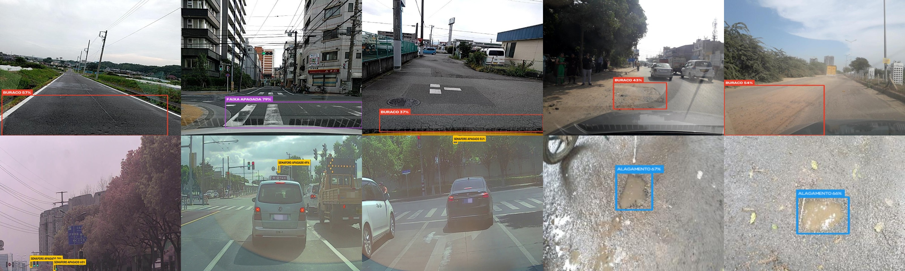

# Olho na Via · Visão computacional

Complemento da entrega de **Edge Computing & Computer Systems**. Uma aplicação Python que processa imagem em tempo real e detecta quatro classes de ocorrência na via urbana:

| # | Classe | Rótulo na tela |
|---|---|---|
| 1 | Buracos / avarias no asfalto | `BURACO` |
| 2 | Semáforos apagados (nenhuma fase luminosa acesa) | `SEMAFORO APAGADO` |
| 3 | Alagamentos / acúmulo de água na pista | `ALAGAMENTO` |
| 4 | Faixas de pedestre apagadas ou desgastadas | `FAIXA APAGADA` |

Sobre cada quadro são desenhados as **caixas delimitadoras**, o **rótulo da classe**, o **nível de confiança**, a contagem por classe e o **FPS em tempo real**. A entrada pode ser a **webcam**, uma **imagem** ou um **vídeo**.

## Como executar

Requer Python 3.10 ou mais novo. Os pesos treinados já estão em `modelos/olho_na_via.pt`.

```powershell
cd edge-computing-e-computer-systems\visao-computacional
python -m venv .venv
.\.venv\Scripts\Activate.ps1

# Com GPU NVIDIA (recomendado). Sem GPU, pule esta linha: roda na CPU, mais devagar.
pip install torch torchvision --index-url https://download.pytorch.org/whl/cu128

pip install -r requirements.txt
```

### Interface web (webcam, upload de imagem ou vídeo)

```powershell
streamlit run app.py
```

Abre em `http://localhost:8501`. Na barra lateral escolha a fonte, a confiança mínima e as classes. O vídeo e a imagem anotados podem ser baixados ao final.

### Janela nativa do OpenCV (maior FPS)

```powershell
python detectar.py                                   # webcam 0
python detectar.py --fonte rua.mp4 --salvar saidas\rua.mp4
python detectar.py --fonte foto.jpg --salvar saidas\foto.jpg --sem-janela
```

`Q` ou `ESC` fecha a janela. `python detectar.py --help` lista as demais opções (`--conf`, `--classes`, `--dispositivo`).

## Como funciona

```
quadro (webcam / imagem / vídeo)
   └─> YOLO11s treinado (768 px) ─> caixas das 4 classes
          └─> verificação de cor nos semáforos ─> desenho (caixas, rótulos, confiança, FPS)
```

- **Modelo:** um único YOLO11s (Ultralytics), ajustado a partir dos pesos do COCO, detecta as quatro classes.
- **Semáforo apagado:** o modelo é treinado com duas classes de semáforo, *apagado* e *aceso*. A classe *aceso* existe só para ensinar a diferença e não é exibida. Como segunda checagem, `olho_na_via/semaforo.py` procura dentro da caixa uma mancha brilhante e saturada em vermelho, amarelo ou verde; se encontra, a detecção de "apagado" é descartada. Nos semáforos do dataset, essa regra não descartou nenhum apagado de verdade e reconheceu cerca de 80% dos acesos.

| Arquivo | Papel |
|---|---|
| `app.py` | Interface Streamlit |
| `detectar.py` | Linha de comando com janela do OpenCV |
| `olho_na_via/detector.py` | Carrega o modelo e devolve as detecções |
| `olho_na_via/semaforo.py` | Verificação de lâmpada acesa por cor (HSV) |
| `olho_na_via/visual.py` | Caixas, rótulos, confiança, contagem e FPS |
| `olho_na_via/classes.py` | Nomes e cores das classes |
| `treino/` | Download dos dados, montagem do dataset e treino |

## Dados de treino

Todas as fontes são públicas, com licença CC BY 4.0, e baixadas sem conta nem chave de API.

| Classe | Fonte | O que foi usado |
|---|---|---|
| Buraco / avaria | [RDD2022](https://doi.org/10.6084/m9.figshare.21431547) (Japão e Índia) | `D40` buraco e `D20` trinca em malha |
| Faixa apagada | RDD2022 (Japão e Índia) | `D43` faixa de pedestre desgastada |
| Semáforo apagado | [S2TLD](https://zenodo.org/records/7352960) | classe `off`; vermelho, amarelo e verde viram a classe auxiliar *aceso* |
| Alagamento | [City Risks](https://zenodo.org/records/6636723) | classe `puddle` |

O dataset montado tem 7.231 imagens de treino e 1.536 de validação.

| Classe | Caixas de treino | Caixas de validação |
|---|---|---|
| buraco | 8.169 | 1.097 |
| semaforo_apagado | 367 | 137 |
| alagamento | 2.008 | 621 |
| faixa_apagada | 693 | 100 |
| semaforo_aceso (auxiliar) | 2.934 | 1.316 |

### Refazer o treino

```powershell
python treino\baixar_datasets.py     # ~4 GB em dados\brutos
python treino\preparar_dataset.py    # monta dados\olho_na_via
python treino\treinar.py             # copia o melhor peso para modelos\olho_na_via.pt
```

Se o treino for interrompido, `python treino\treinar.py --continuar` retoma do último checkpoint.

### Exportar para o navegador

O simulador web (`../simulador`) roda este mesmo modelo no navegador do celular, com o onnxruntime-web. Depois de treinar de novo, gere o arquivo ONNX:

```powershell
python treino\exportar_onnx.py       # grava ..\simulador\static\modelos\olho_na_via.onnx (480 px)
```

Na foto `testes-professor\08-alagamento-1.jpg`, o modelo exportado dá a mesma confiança do original (0,79), no Python e no navegador.

## Resultados

Validação em 1.536 imagens que o modelo não viu no treino (30 épocas, YOLO11s, 768 px):

| Classe | Precisão | Revocação | mAP50 | mAP50-95 |
|---|---|---|---|---|
| Buraco / avaria | 0,67 | 0,49 | 0,56 | 0,26 |
| Semáforo apagado | 0,88 | 0,96 | 0,98 | 0,65 |
| Alagamento | 0,70 | 0,48 | 0,57 | 0,26 |
| Faixa apagada | 0,80 | 0,79 | 0,84 | 0,52 |
| **Média (com a classe auxiliar)** | 0,79 | 0,73 | 0,78 | 0,46 |

Buraco e alagamento são as classes mais difíceis: o modelo acerta cerca de metade das ocorrências anotadas. São alvos pequenos, de contorno irregular e com anotação menos consistente nos datasets de origem.

**Desempenho** em uma RTX 3050 Laptop (4 GB), quadros de 1280×720: cerca de 34 FPS com detecção e desenho; 21 FPS gravando o vídeo anotado ao mesmo tempo.



## Limitações

- **Webcam:** se a imagem vier preta ou muito lenta, a câmera provavelmente está em uso por outro programa (Teams, navegador) ou com a tampa/chave de privacidade fechada.
- **Semáforos:** o S2TLD foi gravado na China, com poucos exemplos de semáforo apagado (504 caixas). Semáforos de LED podem aparecer apagados em quadros isolados de vídeo por causa da cintilação; para um alerta confiável, exija a detecção em vários quadros seguidos.
- **Alagamento:** os exemplos são de poças e água acumulada vistas de perto. Vias totalmente submersas, vistas de longe, tendem a não ser detectadas.
- **Buracos e faixas:** as imagens vêm de câmeras de painel no Japão e na Índia. O asfalto e a sinalização brasileiros são parecidos, mas não idênticos; o ideal é complementar com imagens locais.
- **Faixa apagada:** o modelo aprende o aspecto de faixa desgastada. Não mede o grau de desgaste.
